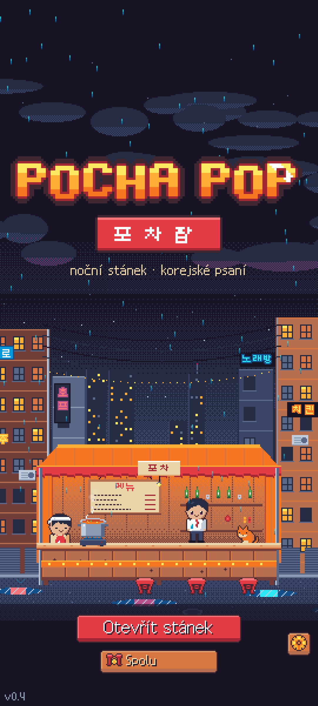
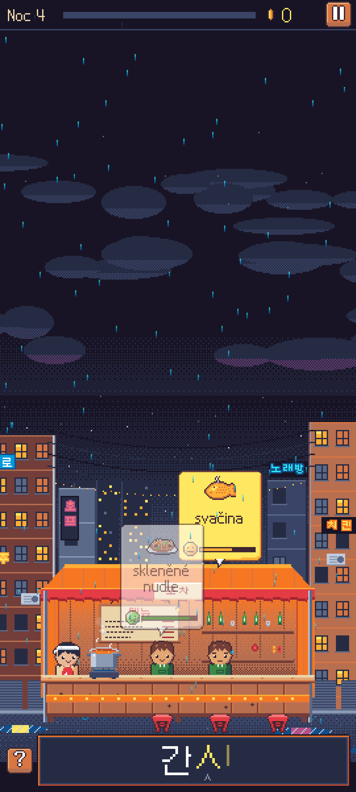
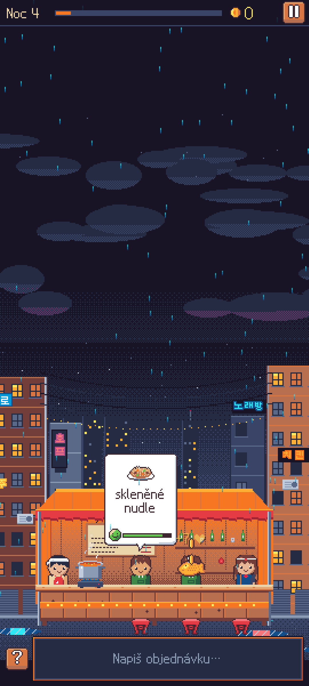
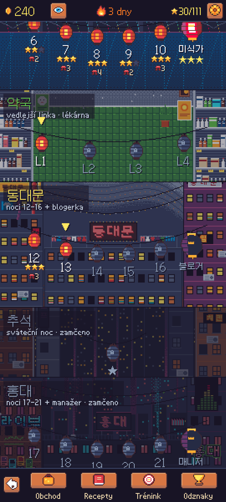
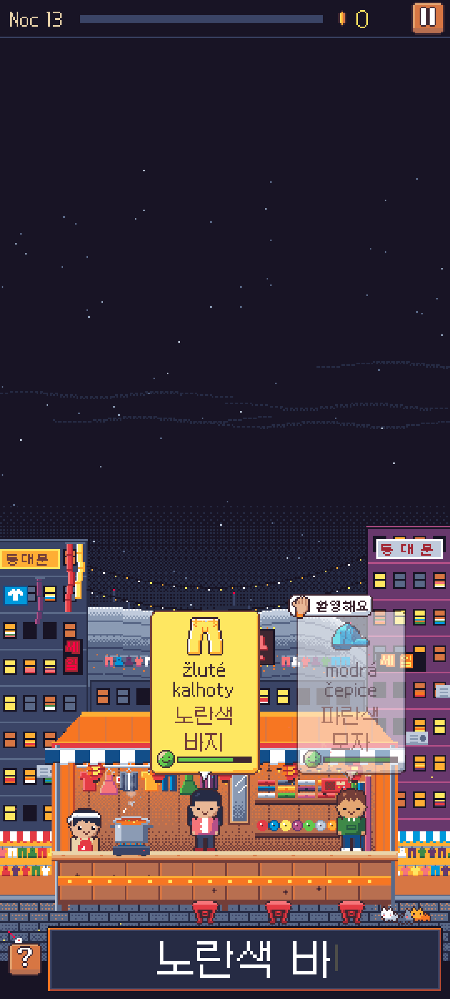
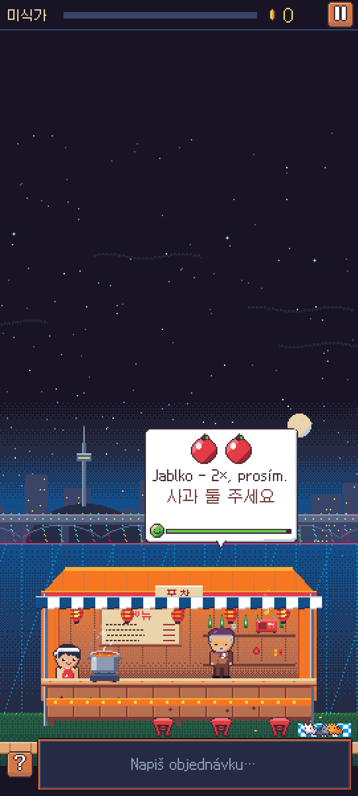
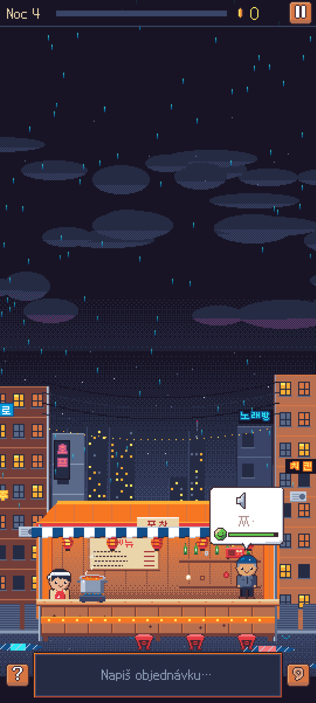
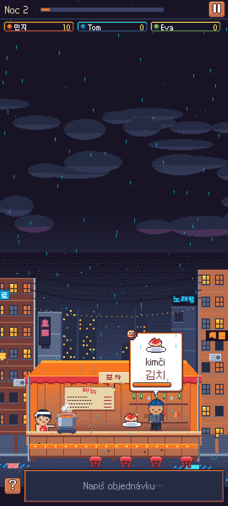

# Pocha Pop 포차팝

Pixel-art hra na učení psaní korejsky (두벌식) na **systémové** korejské klávesnici.
Babička 할머니 ti předala noční stánek 포장마차 v Soulu – zákazníci objednávají v bublinách,
ty objednávku napíšeš korejsky a tím je obsloužíš. Linux desktop + Android.

Obsah (etapy 1–4, zadání `DESIGN.md`, `DESIGN-2.md`, `DESIGN-3.md` a `DESIGN-4.md`):

| Čtvrť | Noci | Herní prvek | Štamgast · boss |
|---|---|---|---|
| 을지로 | 1–5 | jídlo | 김 대리, 하은, kočka 나비 |
| 한강 | 6–10 + 11 | jídlo, pozdravy | kritik 미식가 (věty) |
| 동대문 trh | 12–16 + 116 | barva + věc („빨간색 모자“), reakce přídavnými jmény | 이모 · módní blogerka |
| 홍대 | 17–21 + 121 | přejatá slova (bublina ukáže originál) | 민수 · manažer K-popové skupiny |
| 용산 | 22–26 + 126 | smlouvání 할인 / 싸다, dlouhá slova | 박 사장 · obchodník |
| 부산 přístav | 27–31 + 131 | cíl → doprava (+ 표) | 강 이사 · kapitán (finále) |
| 약국 (vedlejší) | L1–L4 | část těla na obrázku, příznak → lék | lékárnice 약사 |
| svátky | 추석, 크리스마스, 생일 | „pro koho“, sníh, koťata | babička na návštěvě |

198 slov (Recallo balíček + 12 ručně doplněných: 11 barev a 얘기 kvůli ㅒ), všechna jamo včetně ㅆ ㅑ ㅒ ㅖ ㅚ ㅝ ㅢ ㅙ ㅞ.
Navíc: volba počtu míst před nocí (2 · 3 · 4), pomocník 김 대리, pozdravy a poděkování, Barvírna (barvy stánku
a čepičky pro 나비), trénink, denní výzva a 27 odznáčků. Etapa 3: **Spolu** – kooperativní noc pro 2–3 hráče
přes Wi-Fi / hotspot s pravidlem „doběh“ (viz [Hrajeme spolu](#hrajeme-spolu)). Etapa 4: **Poslech** – druhá
kampaň, ve které zákazník objednávku vysloví a ty píšeš, co slyšíš (viz [Poslech](#poslech)).

## Stažení

**[Nejnovější APK pro Android](https://github.com/ROGR3/Pocha-Pop/releases/latest)** (arm64, Android 7+).
Všechny verze s popisem změn jsou v [Releases](https://github.com/ROGR3/Pocha-Pop/releases). Novější verze
se instalují přes starší a uložená hra zůstává. Hra cílí na Android, ale jde spustit i na Linuxu
(viz [Spuštění](#spuštění)).

## Proč „Pocha Pop“

**포차** (pocha) je hovorová zkratka slova **포장마차** (pojangmacha), korejského nočního stánku s jídlem.
Typicky má oranžovou plachtu a plastové stoličky a lidé tam večer jedí 떡볶이 a pijí soju. Přesně takový
stánek ve hře provozuješ. **Pop** je zvuk, se kterým praskne bublina s objednávkou, když slovo napíšeš
správně (a odkaz na hru Hangul Pop, ze které nápad vzešel). **팝** je jen „pop“ napsané hangulem.

## Děj

Babička 할머니 odjíždí na venkov a předá ti svůj stánek v uličce 을지로. Každý večer přicházejí hosté:
unavený úředník 김 대리, studentka 하은, toulavá kočka 나비 a další. Postupně se jim splní jejich malé
příběhy, stánek se rozroste o lampiony, rádio a pomocníka a přestěhuješ se přes 한강, trh 동대문, 홍대
a 용산 až do přístavu v 부산. Na konci každé čtvrti přijde náročný host (kritik, blogerka, manažer,
obchodník, kapitán), který objednává celými větami. Babička ti mezitím posílá pohledy.

## Co se naučíš

- **Psát korejsky na skutečné klávesnici** (두벌식): přesně tu, kterou pak používáš v telefonu nebo na PC.
  Hra porovnává po jednotlivých úhozech, takže vidíš, kde jsi udělal chybu.
- **Slovní zásobu** z Duolinga (vlastní Anki balíček): jídlo, pití, oblečení, barvy, části těla, doprava,
  pozdravy a přídavná jména. Nová písmena a slova přicházejí postupně, noc po noci.
- **Vybavování místo poznávání:** bublina ukazuje obrázek a češtinu, korejštinu musíš vytáhnout z hlavy.
  Čím líp slovo umíš, tím méně nápovědy dostaneš (jednoduché opakování s rozestupy, SRS).
- **Poslech:** ve druhé kampani zákazník objednávku vysloví a ty píšeš, co slyšíš.
- **Hrát spolu:** 2–3 kamarádi na jedné Wi-Fi nebo hotspotu obsluhují společný stánek. Kdo napíše
  objednávku první, dostane plné mince, ostatní ji můžou ještě chvíli „doběhnout“ za polovinu.

## Screenshoty

| | | | |
|---|---|---|---|
|  |  |  |  |
|  |  |  |  |

Všechny obrazovky jsou ve složce [`screenshots/`](screenshots/).

## Spuštění

```bash
npm install            # projektový .npmrc míří na registry.npmjs.org
npm run dev            # jen prohlížeč: http://localhost:1420
npm run tauri dev      # Linux desktop okno (Tauri 2, WebKitGTK)
npm test               # vitest – logika (jamo, matching, obtížnost, SRS, ukládání)
```

### Build

```bash
npm run tauri build                      # Linux: .deb + AppImage v src-tauri/target/release/bundle/
export ANDROID_HOME=<cesta k Android SDK> NDK_HOME=$ANDROID_HOME/ndk/27.0.12077973
npm run tauri android build -- --apk     # APK v src-tauri/gen/android/app/build/outputs/apk/
npm run tauri android build -- --apk --debug   # debug-podepsané APK, dá se rovnou nainstalovat
```

Release APK z `tauri android build` je **nepodepsané**. Instalovatelné APK:

```bash
bash scripts/sign-apk.sh        # build arm64 + podpis lokálním klíčem → release/pocha-pop-<verze>-arm64.apk
```

Klíč (`signing/`, heslo v `signing/key.properties`) se vytvoří při prvním běhu a je v `.gitignore`.
Debug APK (`--debug`) je podepsané automaticky, ale má ~130 MB kvůli ladicím symbolům.

## Nastavení korejské klávesnice

Hra nemá vlastní klávesnici – čte skrytý `<input>` a IME kompozici (`compositionupdate`), takže rozepsanou
slabiku vidíš živě (ㅎ → 하 → 한). První spuštění má návod a testovací pole „napiš 안녕“
(znovu: Nastavení → Návod: korejská klávesnice).

**Linux (fcitx5):**
1. `fcitx5`, `fcitx5-hangul`, `fcitx5-gtk` (na Omarchy už je).
2. `fcitx5-configtool` → přidat vstupní metodu **Hangul**.
3. Přepínání Ctrl+Mezerník (nebo klávesa 한/영).
4. Na Waylandu (Hyprland/Omarchy) to funguje **bez dalšího nastavení** – ověřeno s fcitx5-hangul
   v okně Tauri: živá kompozice (안 → 안녀 → 안녕) i dokončení slova.
5. Na X11 by šlo zkusit `GTK_IM_MODULE=fcitx npm run tauri dev`. Pozor: v testu pod Xvfb se syntetickými
   klávesami (xdotool) se rozepsaná slabika (preedit) do WebKitu nedostala – na skutečném X11 neověřeno.

Testy desktopového okna bez otevírání okna na reálné ploše: `scripts/xvfb-tauri.sh start|shot|focus|key|type|stop`
(izolovaný virtuální X display, vlastní `XDG_DATA_HOME`, takže nesahá na skutečný save).

**Android:**
- Gboard: Nastavení → Jazyky → Přidat klávesnici → Korejština → „2 sady“ (두벌식).
- Samsung klávesnice: Jazyky a typy → 한국어 → Standard.
- Přepínání klávesou se zeměkoulí / tažením mezerníku.
- Aktivita má `adjustResize` a hra se vykresluje do `visualViewport`, takže stánek s bublinami zůstává nad klávesnicí.

## Jak hra funguje

- Text se po rozkladu na jamo průběžně porovnává se všemi čekajícími objednávkami (`src/logic/hangul.ts`).
  Složené samohlásky (ㅘ → ㅗㅏ) a koncové shluky (ㄳ → ㄱㅅ) se rozkládají na klávesy, proto je `한`
  platný mezistav slova `하나`. Mezery se ignorují.
- Mastery slova: 0 = korejština celá v bublině, 1 = jen první slabika, 2+ = jen obrázek + čeština.
  Správně bez chyby +1, chyba −1, slova s chybami chodí častěji (`src/logic/srs.ts`).
- Tab / tlačítko „?“ ukáže korejštinu (bez spropitného, mastery neroste).
- Kombo za sérii bez chyby, spropitné za rychlost, 1–3 hvězdy za noc (bossové 1–5: každá chyba i chybějící
  pozdrav −1 hvězda).
- **Místa u pultu** se volí v popupu noci: 2 (klidná, mince ×1,0), 3 (×1,15), 4 (nával ×1,3, po první noci se 3★).
  Víc míst = víc souběžných objednávek a rychlejší příchody (`spawn × 3/míst`). Bossové mají vždy 3.
- **Pozdravy:** když si host sedne, ukáže se ruka (napiš 안녕하세요 / 환영해요 / 반가워요 → +15 % trpělivosti, +1 mince),
  když odchází, dveře (감사합니다 / 또 오세요 / 또 봐요 / 잘 가요 → +2). Pozdravy jsou dočasné cíle v matchingu;
  když prefix sedí na objednávku i pozdrav, vyhrává objednávka.
- **Reakce** (od 동대문): po jídle host řekne česky „Pálivé!“ → napiš 맵다 (5 s, +2 mince).
- Mince → obchod: lampiony, plachta, rádio (2. stanice po opravě u 박 사장), pomocník 김 대리, menu balíčky;
  **Barvírna** (z obchodu): plachta, cedule, stoličky a lampiony v 11 barvách (barvu „objednáš“ napsáním jejího
  korejského názvu), čepičky pro 나비 – dají se vršit do věže (až 1000, každá za svou pevnou cenu, sundat jde vrchní nebo všechny bez vrácení mincí).
- **Trénink** (mapa): 60 s bublin se slovy s nejvyšší SRS vahou, bez mincí. Tady se dají potkat i barvy.
- **Denní výzva** (nahoře na mapě): stejná noc pro celý den (seed z data), zapisuje se první pokus.
- **Odznáčky** (mapa → Odznaky): 24 úspěchů, získané jsou připnuté na plachtě stánku.
- Receptář po kategoriích (siluety neznámých, rozklad na klávesy), denní série 🔥, pohledy od babičky.

## Hrajeme spolu

Titulní obrazovka → **Spolu**. Napiš jméno (korejsky i latinkou, max. 8 znaků) a vyber barvu.

- **Založit stánek:** telefon hostitele otevře „server“ (port 47123) a ukáže QR kód, krátký kód (`43.1` = poslední
  dva čísla IP adresy) a celou adresu. Hostitel vybírá z **běžných nocí, které má sám odemčené** (čtvrť ◀ ▶, noc ◀ ▶)
  a od 2 hráčů dá **Otevřít stánek**.
- **Připojit se:** *Naskenovat QR* (fotoaparát, jen telefon) nebo napsat krátký kód / celou adresu.
- Všichni vidí stejné zákazníky a objednávky, odbavují všichni, každý píše na svém telefonu.

**Doběh:** kdo objednávku dopíše první, dostane plné mince (vlastní kombo). Bublina u ostatních zůstane, obarví se
barvou prvního hráče (s jeho iniciálou) a místo trpělivosti běží 3 s pruh doběhu: kdo to stihne, dostane polovinu
mincí (bez spropitného), kdo ne, nedostane nic, ale ani chybu. Překlep v doběhu jen přeruší osobní kombo, překlep na
otevřené objednávce se počítá do týmu. Hvězdy jsou společné (chyby = součet / počet hráčů), míst u pultu jsou vždy 4,
zákazníků je víc (`×(1 + 0,35 × (hráčů − 1))`), mince ×1,15 pro všechny. V MP nejsou pozdravy, smlouvání, reakce,
pomocník, štamgasti, bossové, 약국, svátky ani pauza.

Každý si do svého uložení připíše mince a mastery slov, která sám napsal; kampaň (hvězdy nocí) se nemění.
Statistiky `coopNights` / `coopFirst`. Odejde-li host, ostatní hrají dál; zavře-li hostitel stánek, všem se připíšou
mince do té chvíle.

### Dva telefony přes hotspot (návod pro test)

1. Telefon A: zapni **hotspot** (Nastavení → Síť → Hotspot). Telefon B se k němu připojí jako k Wi-Fi.
   (Nebo jsou oba na stejné Wi-Fi – pozor, některé veřejné/hostovské sítě zařízení mezi sebou izolují.)
2. A: Pocha Pop → Spolu → Založit stánek. Na displeji je QR a kód, např. `43.1` (hotspot Androidu bývá `192.168.x.1`).
3. B: Spolu → Připojit se → Naskenovat QR (povolit fotoaparát) nebo napsat kód `43.1`.
4. A vybere noc a dá Otevřít stánek. Píšou oba; kdo je první, toho barvou se bublina u druhého obarví.
5. Když se B nepřipojí: oba ve stejné síti? Má A víc adres („Jiná adresa“), zkus na B napsat tu celou.

Desktop (Linux) funguje jako hostitel i host, jen ho neladíme: hostitel potřebuje povolený TCP port 47123
(`sudo ufw allow 47123/tcp`, když běží UFW).

### Jak to funguje uvnitř

- Sítě se dotýká jen Rust (`src-tauri/src/net.rs`, tokio-tungstenite + if-addrs): Android WebView neumí naslouchat
  a `ws://` z `tauri.localhost` naráží na mixed-content. Příkazy `net_host_start/stop`, `net_join`, `net_send`,
  `net_kick`, `net_leave`, `net_local_ips`; eventy `net://open|msg|close|error`. Max. 2 hosté (3. dostane close 4001
  „full“), ping po 5 s, odpojení po 10 s ticha.
- Protokol (`src/logic/netproto.ts`, `PROTO = 2`; 2 = `lobby`/`start` nesou stopu Čtení/Poslech): JSON zprávy, `decode()` validuje. Hostitel je rozhodčí
  (`src/logic/coop.ts` `CoopReferee`, `src/game/coopHost.ts`); sám hraje stejnou cestou (lokální zprávy).
  Zákazníci jdou k pultu pevně 1,6 s a trpělivost se počítá z hodin hostitele (`tick` každé 2 s).
  Odchylky od zadání: `spawn` nese navíc `at` (čas hostitele) a `done` navíc `clean`/`hinted` (kvůli kombu
  a spropitnému); přibyl příkaz `net_kick`.
- V prohlížeči (Vite / Playwright) nahrazuje Rust `scripts/mp-relay.mjs` (`npm run mp-relay`, port 47200,
  stránka s `?relay=ws://host:47200`).

### Testy multiplayeru

```bash
npm test                                  # coop.ts, netproto.ts, migrace save v3
(cd src-tauri && CARGO_BUILD_JOBS=4 cargo test --lib)   # relay: 2 hosté, 3. odmítnut, broadcast, odpojení
npm run mp-e2e                            # relay + 3 Playwright stránky: lobby → noc → výsledky
node scripts/mp-bot.mjs 127.0.0.1:47123   # bot jako host proti Tauri hostiteli (Xvfb) nebo telefonu
```

**Telefon přes adb** (`scripts/mp-phone.mjs`): potřebuje debug build `cz.rogr.pochapop.debug` (instaluje se vedle
release verze, má vlastní uložení), protože jen u něj jde WebView ovládat přes DevTools (`scripts/adb-cdp.mjs`).
Tlačítka se mačkají skutečným `adb input tap` (souřadnice se počítají z objektů hry), psaní je emulace IME.

```bash
npm run tauri android build -- --apk --debug --target aarch64
adb install -r src-tauri/gen/android/app/build/outputs/apk/universal/debug/app-universal-debug.apk
node scripts/mp-phone.mjs host    # telefon hostí, PC bot se připojí přes adb forward
bash scripts/xvfb-tauri.sh start  # (+ Spolu → Založit stánek, viz AGENTS) a pak:
node scripts/mp-phone.mjs guest   # telefon se připojí k PC přes adb reverse na 127.0.0.1
```

Ověřeno na Pixelu 8a (Android 17): telefon jako hostitel i jako host, celé noci, mince v uložení.
QR skener se otevírá, Zpět ho zavře (samotné skenování kódu je potřeba vyzkoušet ručně).

## Poslech

Nastavení → **Režim kampaně: Čtení · Poslech** (nebo štítek s okem/uchem v hlavičce mapy). Poslech je zrcadlo celé
kampaně: začíná se od noci 1 a všechno se hraje znovu (hvězdy, čtvrti, bossové, 약국, svátky). Přepnutím zpět jsi
tam, kde jsi byl/a ve Čtení. Mapa je v Poslechu modřejší a nad nedohranými nocemi visí nota místo šipky.

- **Zvlášť pro každou stopu:** noci, mastery slov, kapitoly štamgastů, denní výzva, trénink.
  **Společné:** mince, vylepšení, Barvírna, odznáčky, statistiky, nastavení, co-op jméno, série dní.
  Příběhové scény se v Poslechu přehrají znovu; když už je hráč viděl, mají tlačítko **Přeskočit**.
- Zákazník si sedne a objednávku **řekne** korejsky (systémový hlas Androidu); bublina ukazuje jen reproduktor
  (vlnky, dokud mluví) a trpělivost, která začne ubývat až po doznění. Bublina nikdy neukáže slovo: podle mastery
  **z Poslechu** napoví první souhlásku (`ㄱ·`), pak jen počet slabik, pak nic. Nápověda „?“ ukáže celé slovo
  (bez spropitného) jako vždy.
- **Znovu:** ťuknout na bublinu, nebo na ucho vpravo od psaní (když čeká jen jeden). První opakování zdarma, každé
  další = objednávka bez spropitného, a od druhého se mluví pomalu (0,75). Po překlepu se objednávka sama jednou
  pomalu zopakuje.
- Po obsloužení ukáže bublina na 1,5 s obrázek + korejštinu + češtinu, pak praskne.
- Kočka 나비 jen řekne 야옹 a ukáže obrázek. Pozdravy beze změny. Reakce po jídle zákazník vysloví, obchodník
  v 용산 řekne „할인?“.
- Nastavení: rychlost hlasu Normální / Pomalá, hlasitost hlasu. Když zařízení nemá korejský hlas, Poslech je
  zašedlý („Chybí korejský hlas“) a tlačítko **Stáhnout hlas** otevře systémovou instalaci hlasů.
- Trénink a denní výzva běží v aktuální stopě, receptář má u slova dvě řady mistrovství (oko / ucho) a tlačítko
  **Přehrát**. Co-op: hostitel v čekárně volí Čtení / Poslech (výchozí = jeho stopa); každý telefon mluví sám
  a telefon bez korejského hlasu hraje stejnou noc se čtením (v čekárně vidí varování).
- Odznáčky: **Dobré ucho** (první noc v Poslechu), **Bez opakování** (noc v Poslechu bez jediného přehrání navíc),
  **Slyším Soul** (kritik 미식가 v Poslechu).

### Jak to funguje uvnitř

- Save v4 (`src/logic/save.ts`, `src/logic/track.ts`): `tracks: { read, listen }` s `nights/words/friends/daily/
  training`, `settings.track`, `voiceRate`, `voice`, `storySeen`. Migrace v3 → v4 přesune dosavadní postup do
  `tracks.read` a odvodí z něj už viděné scény. Scény pracují přes `G.track()` / `G.stat()`; sdílené odemykání
  (obchod, rádio) bere lepší z obou stop.
- Hlas: `src-tauri/gen/android/app/src/main/java/cz/rogr/pochapop/TtsPlugin.kt` (Tauri mobile plugin v app modulu,
  `TextToSpeech` + `Locale.KOREAN`, inicializace při startu aplikace, kontrola nainstalovaného korejského hlasu)
  a `src-tauri/src/tts.rs`: příkazy `tts_status`, `tts_speak(text, rate, volume, id)`, `tts_stop`,
  `tts_install_data` (`ACTION_INSTALL_TTS_DATA`), event `tts://done {id}`. Na desktopu `tts_status` vrací
  `available: false`. Manifest má `<queries>` s `TTS_SERVICE` (Android 11+ jinak engine nenajde).
- `src/game/speech.ts`: fronta (zákazníci mluví po jednom, 250 ms pauza), ducking deště/rádia na 40 %, backendy
  `TauriTts`, `WebSpeechTts` (prohlížeč s korejským hlasem) a `MockTts` (`?tts=mock`: „mluví“ 120 ms na slabiku
  a zapisuje do `__pocha.spoken`).
- **Odchylky od zadání:** plugin není samostatný crate, ale třída v app modulu registrovaná z `tts.rs`
  (`register_android_plugin`), a hra ho volá přes app příkazy `tts_*` (příkazy `plugin:tts|…` by potřebovaly ACL
  oprávnění); `tts://done` přeposílá Rust z kanálu pluginu. V co-opu běží trpělivost dál na hodinách hostitele –
  v Poslechu k ní hostitel přičte čas mluvení (2 × odhad + 1,5 s), protože každý telefon mluví sám.
  Šéfkuchař úvodního dialogu je nová postava `chef` (portrét kuchaře).

### Testy Poslechu

```bash
npm test                     # track.ts, migrace v3→v4 i v1→v4, pravidla přehrání, fronta řeči, odznáčky, netproto v2
npm run autoplay:listen      # LISTEN=1: MockTts, bot píše jen to, co slyšel (__pocha.spoken) – noci 1, 2, 11, 12 (동대문)
npm run mp-e2e               # obsahuje i noc v Poslechu (hostitel poslouchá, host bez hlasu čte)
```

Autoplay v Poslechu zároveň hlídá, že bublina nikdy neobsahuje text objednávky.

Telefon (Pixel 8a, Google TTS): ověřeno `node scripts/tts-phone.mjs` (debug build, **potichu** – hlasitost 0, žádné
dotyky): `tts_status` = engine + korejský hlas, tři promluvy po sobě s mezerou ~250 ms, konec hlásí `tts://done`
(ne pojistný timeout), ducking 0,4 → 1, logcat `tts: init status=0 korean=true`. Release 0.4.0 nainstalované přes 0.3.0.

## Přidání slov

1. Uprav `scripts/build-words.ts`: `FOOD` (jídla), `MORE` (ko → [česky, ikona, id, kategorie]), `MORE_BY_ID`
   (homonyma jako 배 břicho/loď), `EXTRA` (slova mimo balíček – vždy s komentářem proč), `LOAN_ORIGINAL`.
2. `WORDS_TSV=<cesta k anki_korean.txt> npm run words` → přegeneruje `src/data/words.json` (obtížnost se počítá skriptem).
3. Nakresli ikonu (viz níže) se stejným jménem a přidej slovo do noci v `src/data/levels.ts`.
4. `npm test` – test ohlídá ikony, existenci slov i to, že noc používá jen už představená jamo.

## Kreslení assetů

Všechno je kreslené v Aseprite skripty (Lua) – žádné generátory, žádné placeholdery.

```bash
npm run art                          # přestaví všechno: art/src/*.lua → art/*.aseprite + public/assets/*.png/.json
bash scripts/build-art.sh icons      # jen jeden skript
bash scripts/preview.sh icons 8      # zvětšený náhled PNG do /tmp
bash scripts/make-icons.sh           # app ikony (desktop + Android) z public/assets/appicon.png
```

- `art/lib.lua` – paleta **Endesga 32** (písmena a–z, A–F), ASCII pixel mapy, elipsy se stínováním,
  automatický obrys, dither, malé hangul glyfy pro neony, barevné rampy `L.RAMPS` (palette swap pro Barvírnu
  a oblečení).
- `art/chargen.lua` – generátor postav 32×40 (sdílí `characters*.lua`), `art/icons/*.lua` – části sheetu ikon
  (`bash scripts/preview-icons.sh <část>` = izolovaný náhled bez zápisu do `public/assets`).
- Oblečení je ve vlastním sheetu `clothes` (12 snímků na věc: neutrální šedá + 11 barev), ikony v bublinách
  se odkazují jako `cl:<věc>:<barva>`.
- Aseprite cesta se bere z `ASEPRITE_PATH` nebo `tools/aseprite-mcp/.env`.
- MCP server `aseprite` (`.mcp.json`, `tools/aseprite-mcp`) jde použít pro interaktivní kreslení a `export_frame`.

## Ekonomika

`npx vite-node scripts/economy.ts` simuluje tři typy hráčů (všechny noci jednou, v pořadí odemykání):

| Hráč | po 미식가 (11) | po 용산 (126) | po 부산 (131) | na konci (303) |
|---|---|---|---|---|
| pomalejší (2★, 2 místa) | 709 | 2 255 | 2 698 | 3 099 |
| normální (2–3★, 3 místa) | 922 | 2 934 | 3 543 | 4 086 |
| zkušený (3★, 4 místa) | 1 626 | 4 905 | 5 875 | 6 781 |

Kombo platí ×1 / ×1,5 (od 5) / ×2 (od 10), místa u pultu ×1 / ×1,15 / ×1,3 (co-op ×1,15).
Ceny: upgrady a menu balíčky 2 500, jedna od každé čepičky 135, každá barva na každé části stánku 5 500 – dohromady 8 135.
Čepičky se dají vršit (20–40 za kus), takže věž pro 나비 je nekonečné místo pro přebytečné mince.
Normální hráč si za první průchod koupí všechny upgrady a pár oblíbených barev (500 za barvu na celý stánek),
na všechno nemá nikdo; zbytek je na opakování nocí, denní výzvy a co-op.

## Zvuk

`npm run sfx` vygeneruje SFX (`npm run sfx -- beaten runoff_ok` jen vybrané – šum není seedovaný) (`scripts/gen-sfx.mjs`, sfxr-style syntéza) do `public/sfx/*.wav`.
Déšť / řeka a lo-fi smyčka rádia jsou procedurální WebAudio (`src/game/audio.ts`).

## Generování screenshotů

`npm run screenshots` – build + `vite preview` + Playwright, všechny obrazovky v rozlišení
mobil 412×915 (@2.625) a desktop 450×800 do `screenshots/`. Jen část: `ONLY=23,24 npm run screenshots`
(prefixy názvů); na konci se přes `mp-e2e --shots` přidají obrazovky Spolu (`mobile-6x-coop-*`). `npm run autoplay` – bot dohraje první noc a bosse každé čtvrti, 약국, svátky a denní výzvu
přes skutečné UI (emulace IME), `node scripts/autoplay.mjs 12 116` jen vybrané noci.

## Licence a zdroje

Písmo [Galmuri](https://github.com/quiple/galmuri) (SIL OFL, `public/fonts/OFL-Galmuri.md`).
Slova z vlastního Anki balíčku (Recallo), přeložená do češtiny.
